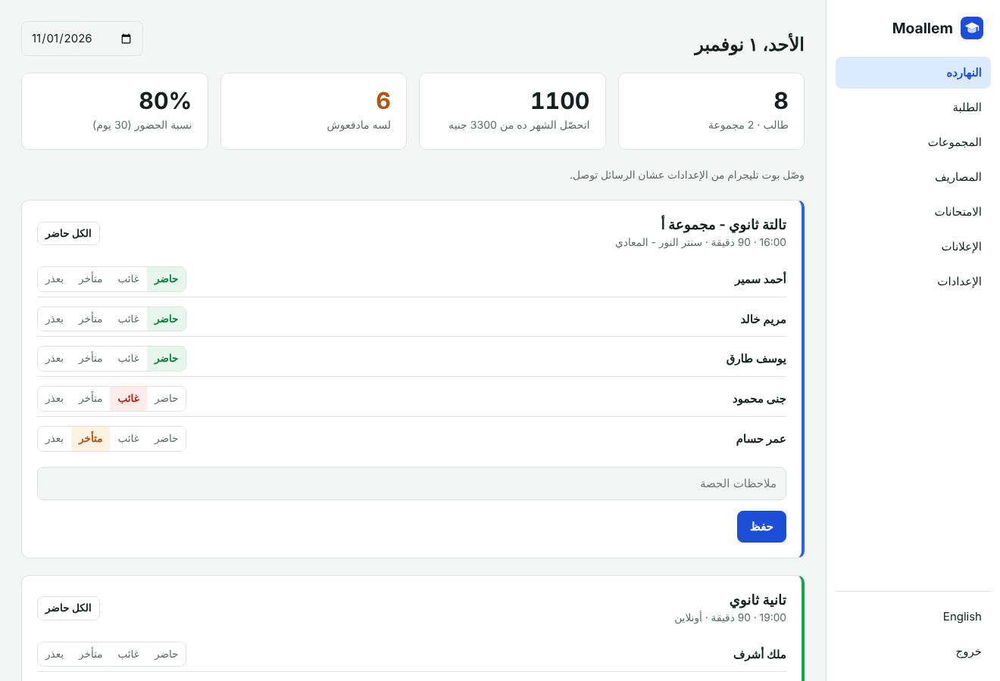
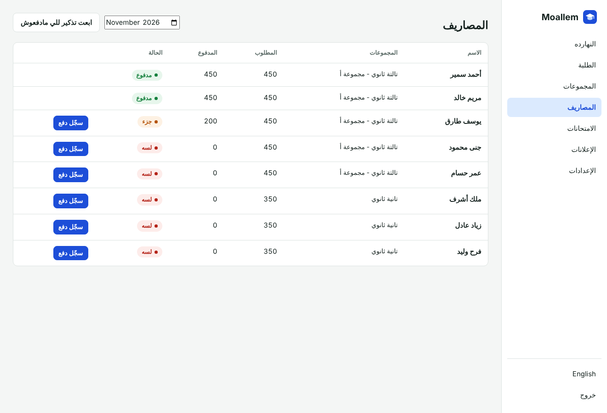
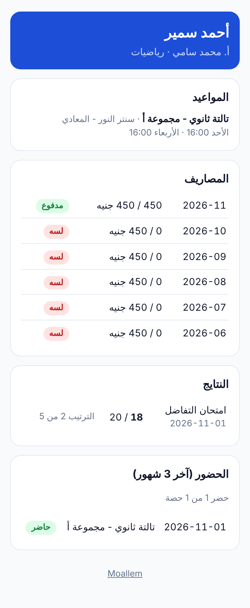

<div align="center">

# Moallem · مُعلّم

**Run your private lessons like a pro.**
Groups, students, attendance, monthly fees, exam results, and automatic Telegram messages to students and parents. Open source, self-hosted, no monthly fees. Built for private tutors and small learning centers.

[](https://www.hostinger.com/docker-hosting?compose_url=https://raw.githubusercontent.com/mashraf1997/moallem/main/docker-compose.yml&REFERRALCODE=YOUR_REFERRAL_CODE)

[English](#what-it-does) · [العربية](#بالعربي)



</div>

---

## What it does

- **Today at a glance.** Your classes for the day from each group's weekly schedule. Take attendance in a few taps: present, absent, late or excused.
- **Parents know right away.** When a student is marked absent, their parent gets a Telegram message.
- **Fees without awkward talks.** Monthly fees per group, or a custom fee per student. Record full or partial payments, see who has not paid, and send polite reminders automatically on the day you choose.
- **Exam results.** Enter scores, publish them, and each student and parent gets their score and rank.
- **Announcements.** "Next class is a revision": one message to a group or everyone, students and parents.
- **A page for every student.** A private link with the schedule, attendance, fees and results, shared with the parent. From it, they connect Telegram with one tap.
- **Class reminders** before each session.
- **Arabic and English**, right-to-left ready, works on a phone.

<p align="center">
  
  
</p>

## Deploy

**One click:** press **Deploy on Hostinger** above, open `http://YOUR-SERVER-IP` and create your password.

**Docker:**

```bash
git clone https://github.com/mashraf1997/moallem.git && cd moallem
docker compose up -d
```

**Node.js 20+:** `npm start`. No dependencies at all.

### Telegram

1. Create a bot with [@BotFather](https://t.me/BotFather) and paste its token in **Settings**.
2. Send each student their page link (**Students → Student page** copies it).
3. On that page, the student and the parent each tap their button to connect.

| Variable | Default | Purpose |
|---|---|---|
| `PORT` | `3000` | HTTP port |
| `DATA_DIR` | `./data` | Where `moallem.json` is stored. Back it up. |
| `SETUP_TOKEN` | *(empty)* | Required to create the first admin when set |
| `DEMO_MODE` | `false` | `true` makes this a public demo: sample data, a reset every hour, and settings that reach outside (tokens, keys, password) locked |
| `DEMO_PASSWORD` | `demo1234` | Password shown on the demo sign-in screen |
| `DEMO_RESET_MINUTES` | `60` | How often the demo data resets (minimum 5) |
| `DEMO_LANG` | `ar` | Language of the sample data: `ar` or `en` |

## Development

```bash
npm test     # runs against a fake Telegram server
```

## More open-source tools for small businesses

[Wakeel](https://github.com/mashraf1997/wakeel) (AI customer service) · [Dukkan](https://github.com/mashraf1997/dukkan) (WhatsApp store) · [Mawid](https://github.com/mashraf1997/mawid) (bookings) · [Nashr](https://github.com/mashraf1997/nashr) (social media) · [Khatm](https://github.com/mashraf1997/khatm) (loyalty cards)

## License

MIT

---

<div dir="rtl">

## بالعربي

**مُعلّم** نظام مفتوح المصدر للمدرسين الخصوصيين والسناتر الصغيرة: المجموعات، والطلبة، والحضور، والمصاريف الشهرية، ونتايج الامتحانات، ورسائل تليجرام تلقائية للطلبة وأولياء الأمور.

- **حصص النهارده قدامك** وتسجّل الحضور بضغطة: حاضر، غائب، متأخر، أو بعذر.
- **ولي الأمر يعرف على طول** لو ابنه غاب.
- **المصاريف من غير إحراج:** مصاريف لكل مجموعة أو مصاريف خاصة لطالب، ودفع كامل أو جزء، وتذكير تلقائي في اليوم اللي تختاره.
- **النتايج:** تكتب الدرجات وتنشرها، وكل طالب وولي أمر يوصله درجته وترتيبه.
- **إعلانات** لمجموعة أو للكل.
- **صفحة لكل طالب** فيها المواعيد والحضور والمصاريف والنتايج، ومنها يربط تليجرام بضغطة.

</div>
